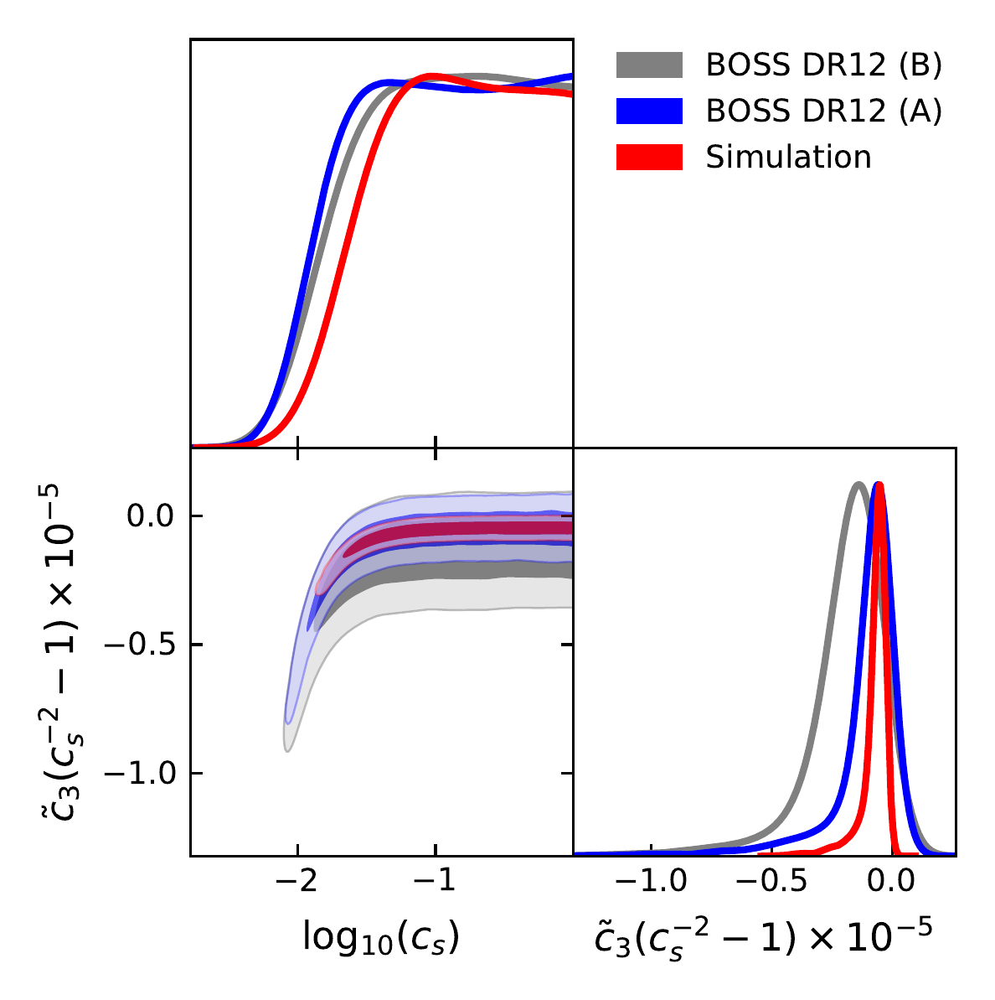
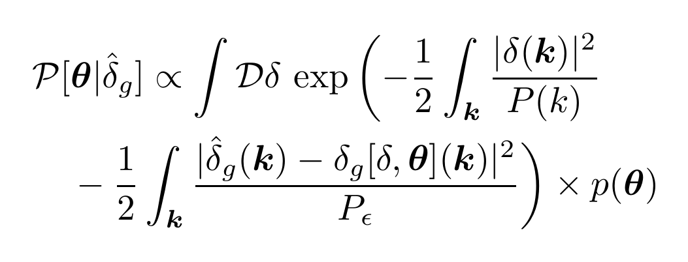
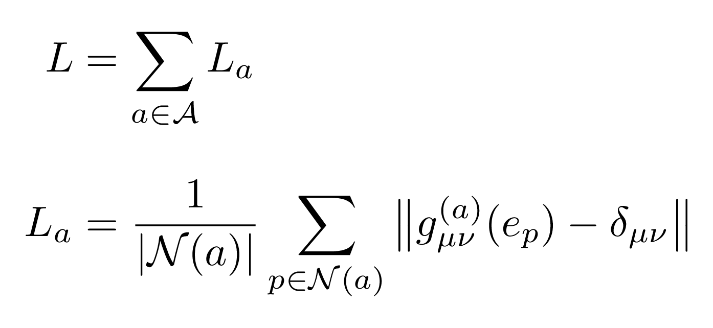

(See [InspireHEP](https://inspirehep.net/authors/1424071) for the full publication list.)

## Primordial non-Gaussianity

Inflation could have taken place at energy scales as high as H ∼ 10¹⁴ GeV — far beyond the reach of any terrestrial collider — possibly making it one of the few available windows onto particle physics at those energies. Primordial non-Gaussianity probes inflation's field content directly: how many fields were dynamically important, how fast fluctuations propagated, and whether massive particles beyond the inflaton were around and coupled to it. We built full-shape analyses of the BOSS galaxy power spectrum and bispectrum, consistently including the one-loop corrections sourced by primordial non-Gaussianity (PNG), to search for these signatures directly in large-scale structure rather than relying on the CMB alone. This gave the first LSS constraints on equilateral and orthogonal PNG, independent of the CMB, and the resulting bound on the inflaton sound speed; a joint power-spectrum-and-bispectrum constraint on local PNG — whose detection would rule out all single-field inflation — with the bispectrum tightening the bound and breaking its degeneracy with galaxy bias; and the first dedicated search for a Cosmological Collider signal from a massive spin-zero particle coupled to the inflaton. None of these show evidence for new physics, but together they establish galaxy surveys as a genuine route to inflationary spectroscopy, with upcoming data poised to tighten these bounds substantially.

Key papers: Cabass et al. (2022), [arXiv:2201.07238](https://arxiv.org/abs/2201.07238); Cabass et al. (2022), [arXiv:2204.01781](https://arxiv.org/abs/2204.01781); Cabass et al. (2024), [arXiv:2404.01894](https://arxiv.org/abs/2404.01894)

## Large-scale structure and field-level inference

Standard large-scale-structure analyses compress the galaxy density field into a power spectrum (and, less often, a bispectrum) before fitting cosmological parameters, which throws away information and makes the higher n-point functions and their covariances expensive to control. Field-level inference instead fits a forward model of the nonlinear galaxy field directly to the data. With Marko Simonović and Matias Zaldarriaga, we derived an analytic expression for this field-level posterior in the small-noise limit, by inverting a perturbative forward model order by order; in the perturbative case it contains exactly the same information as the n-point functions at the same perturbative order, but we found long-short mode couplings that degrade standard power-spectrum/bispectrum constraints while leaving the field-level posterior optimal, motivating simpler near-optimal estimators. In a follow-up with Kazuyuki Akitsu and Shi-Fan Chen, we tested this numerically, using MCMC to jointly constrain the amplitude, dark-matter density and Hubble constant from mock data in real and redshift space, and confirmed that the field-level posterior indeed delivers the unbiased, near-optimal constraints predicted analytically — provided the noise model itself is correctly specified.

Key papers: Cabass, Simonović & Zaldarriaga (2023), [arXiv:2307.04706](https://arxiv.org/abs/2307.04706); Akitsu et al. (2025), [arXiv:2509.09673](https://arxiv.org/abs/2509.09673)

## Machine learning for cosmology

Comparing two posteriors on the same cosmological parameters — from two different datasets, pipelines, or analysis choices — usually comes down to checking whether their credible regions overlap in parameter space, the standard way of asking whether two measurements are in tension. But raw distance in parameter coordinates isn't on its own physically meaningful: parameters can be reparametrized freely, and the same coordinate separation can correspond to very different changes in the actual observable depending on where in parameter space it's evaluated. A decoder that maps parameters to a compressed representation of the power spectrum gives a way around this: its Jacobian induces a genuine Riemannian metric on parameter space, inherited directly from distances between power spectra — this decoder is a dedicated cosmological emulator, distinct from the metric-preserving autoencoder discussed below, and the geodesic distance it induces between two parameter points is what I'm now computing via energy minimization. That geodesic distance turns "how far apart are two posteriors" into "how different are the power spectra they actually imply" — giving overlap and tension a physical distance to refer to, not just a coordinate-dependent one.

Dimensionality reduction of high-dimensional signals — waveforms, power spectra — is usually done with linear methods like SVD, which can introduce redundancy when the signals actually span a curved, nonlinear manifold. We built *metric-preserving autoencoders*: on top of the usual reconstruction loss, they directly enforce that distances in the compressed latent space match distances in the original space, either locally (penalizing the decoder's Jacobian pointwise) or globally (matching pairwise distances across a batch). Metric preservation means a template bank can be built by simply placing a uniform grid in the latent space, and the resulting banks need fewer dimensions than an SVD-based bank with the same coverage — demonstrated on real gravitational-wave template banks. The same construction carries over to cosmological parameter estimation, where curvature can also be computed directly in the compressed representation, and tested for whether a learned coordinate change can flatten that metric back to Euclidean.

Key paper: Cabass, Wadekar, Zaldarriaga & Zhou (2025), [arXiv:2511.10466](https://arxiv.org/abs/2511.10466)

Code: [GW template-bank autoencoder (on GitHub)](https://github.com/giovanni-cabass/autoencoder_GWs), [cosmological-manifold autoencoder (on GitHub)](https://github.com/giovanni-cabass/autoencoder_manifold_geodesics)

## Reproducible agent-based research in theoretical cosmology

Using LLM coding agents for real theoretical-physics derivations — tensor calculus in a curved, time-dependent background, effective-field-theory construction — is failure-prone in a specific way: a derivation can read as fluent and confident while quietly getting a sign, an index placement, or which form of a metric applies in a given step wrong. My response was to build a workflow around machine-checked claims: every physics statement that matters is backed by an actual, machine-verified derivation (symbolic tensor calculus in Mathematica/Wolfram Language), tracked in a structured result ledger — one entry per claim, each pointing to the note it's stated in and the script and clean log that verify it, with explicit dependencies on other claims — checked automatically for internal consistency before anything is promoted into it, and never promoted without a human first reading the note and naming the result. A public repository excerpts this workflow applied to one worked result from an ongoing project constructing the DBI Cosmological Collider — an effective field theory for inflationary fluctuations coupled to a massive spinning field, built to respect the DBI boost symmetry: the physics note, the Mathematica verification scripts, and the claim ledger and checking tool that tie them together, end to end. This is one instance of a broader verification workflow applied across my current theoretical-physics research, including work on the Effective Field Theory of Large-Scale Structure.

This ledger-based approach to verifiability converges, independently, with a public precedent for numerical work — Matias Zaldarriaga's [arXiv:2606.30527](https://arxiv.org/abs/2606.30527) ships a claims registry tracing every quoted number in a paper back to the script and data that produced it — adapted here to a different kind of claim: a symbolic tensor-calculus identity or invariance statement, traced to a machine-verified derivation rather than a numerical script.

Demo: [DBI claims-verification demo (on GitHub)](https://github.com/giovanni-cabass/dbi_claims_demo)

