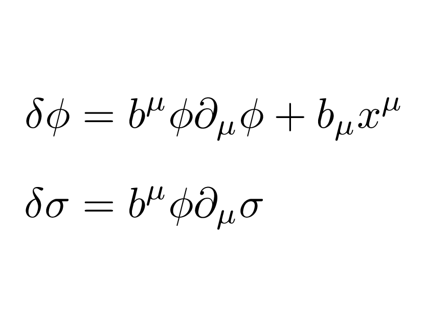

See [InspireHEP](https://inspirehep.net/authors/1424071) for the full publication list.

## Primordial non-Gaussianity

Placeholder description. Replace with a few sentences on what the problem is, what you have done, and why it matters.

Key papers: [Author & Cabass 2024](#), [Cabass et al. 2023](#)

## Large-scale structure and field-level inference

Placeholder description. Replace with a few sentences on what the problem is, what you have done, and why it matters.

Key papers: [Cabass et al. 2024](#), [Author, Cabass & Author 2022](#)

## Machine learning for cosmology

Dimensionality reduction of high-dimensional signals — waveforms, power spectra — is usually done with linear methods like SVD, which can introduce redundancy when the signals actually span a curved, nonlinear manifold. We built *metric-preserving autoencoders*: on top of the usual reconstruction loss, they directly enforce that distances in the compressed latent space match distances in the original space, either locally (penalizing the decoder's Jacobian pointwise) or globally (matching pairwise distances across a batch). Metric preservation means a template bank can be built by simply placing a uniform grid in the latent space, and the resulting banks need fewer dimensions than an SVD-based bank with the same coverage — demonstrated on real gravitational-wave template banks. The same construction carries over to cosmological parameter estimation: a decoder mapping cosmological parameters to a compressed representation of the matter power spectrum induces a Riemannian metric on parameter space, letting geodesic distances and curvature be computed directly in the compressed representation, and tested for whether a learned coordinate change can flatten that metric back to Euclidean.

Key paper: Cabass, Wadekar, Zaldarriaga & Zhou (2025), [arXiv:2511.10466](https://arxiv.org/abs/2511.10466)

Code: [GW template-bank autoencoder (on GitHub)](https://github.com/giovanni-cabass/autoencoder_GWs), [cosmological-manifold autoencoder (on GitHub)](https://github.com/giovanni-cabass/autoencoder_manifold_geodesics)

## Reproducible agent-based research in theoretical cosmology

Using LLM coding agents for real theoretical-physics derivations — tensor calculus in a curved, time-dependent background, effective-field-theory construction — is failure-prone in a specific way: a derivation can read as fluent and confident while quietly getting a sign, an index placement, or which form of a metric applies in a given step wrong. The response was to build a workflow around machine-checked claims: every physics statement that matters is backed by an actual, machine-verified derivation (symbolic tensor calculus in Mathematica/Wolfram Language), tracked in a structured result ledger — one entry per claim, each pointing to the note it's stated in and the script and clean log that verify it, with explicit dependencies on other claims — checked automatically for internal consistency before anything is promoted into it, and never promoted without a human first reading the note and naming the result. A public repository excerpts this workflow applied to one worked result from an ongoing project constructing the DBI Cosmological Collider — an effective field theory for inflationary fluctuations coupled to a massive spinning field, built to respect the DBI boost symmetry: the physics note, the Mathematica verification scripts, and the claim ledger and checking tool that tie them together, end to end. This is one instance of a broader verification workflow applied across Giovanni Cabass's current theoretical-physics research, including work on the Effective Field Theory of Large-Scale Structure.

This ledger-based approach to verifiability converges, independently, with a public precedent for numerical work — Matias Zaldarriaga's [arXiv:2606.30527](https://arxiv.org/abs/2606.30527) ships a claims registry tracing every quoted number in a paper back to the script and data that produced it — adapted here to a different kind of claim: a symbolic tensor-calculus identity or invariance statement, traced to a machine-verified derivation rather than a numerical script.

Demo: [DBI claims-verification demo (on GitHub)](https://github.com/giovanni-cabass/dbi_claims_demo)

