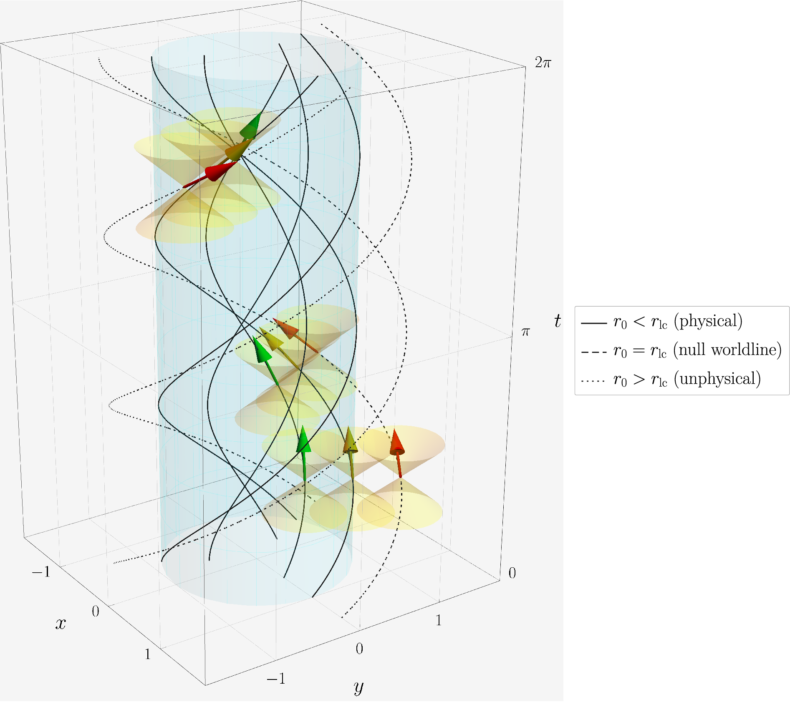
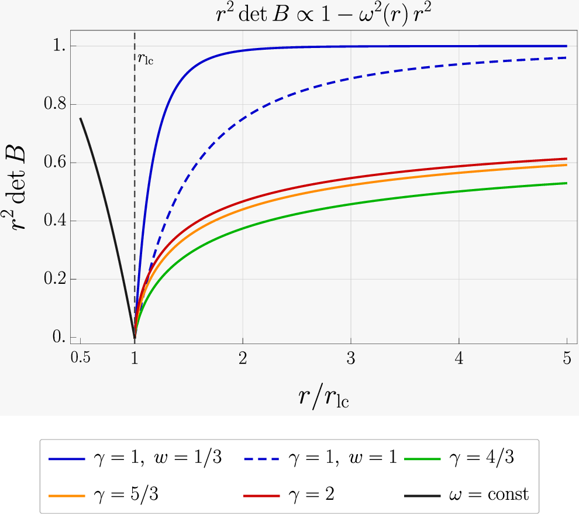

This post works through a set of calculations on a nonlinear sigma model of three scalar fields whose stress-energy tensor takes the perfect-fluid form exactly — for every Lagrangian in the family. The fields $\phi^{I} = (r_{L}, \varphi_{L}, z_{L})$ are the Lagrangian (material) coordinates of the fluid: they label individual fluid elements, and their level sets trace out the element worldlines. The Lagrangian is $\mathcal{L} = \Lambda^4 F(X)$, where $X = \det G \cdot \det B$ packs the target-space metric determinant and kinetic matrix determinant into a single scalar. Four results stand out: the stress-energy tensor is a perfect fluid for every smooth $F$; constant rigid rotation singles out the logarithmic family $F = \alpha \ln X$ with the equation of state $p + \rho = \mathrm{const}$; a pressureless fluid ($p = 0$) cannot rotate; and for a linear equation of state $p = w\rho$ the rotation profile is the explicit power law $\omega \propto r^{-(1+w)/w}$.

---

## The model

We work in flat Minkowski spacetime in cylindrical coordinates $(t, r, \varphi, z)$ with metric $g_{\mu\nu} = \mathrm{diag}(-1, 1, r^{2}, 1)$ and $\sqrt{-g} = r$. The action is

$$S = \Lambda^4 \int {\rm d}^{4}x\,\sqrt{-g}\;F(X)\,\,,$$

with $F$ an arbitrary smooth function, $F' \equiv {\rm d}F/{\rm d}X$, and $\Lambda$ an energy scale (${[\Lambda]} = L^{-1}$). The argument is

$$X \equiv \det G \cdot \det B\,\,,\qquad B^{IJ} \equiv g^{\mu\nu}\nabla_\mu\phi^{I}\nabla_\nu\phi^{J}\,\,,$$

where $G_{IJ}(\phi)$ is the target-space metric and $B^{IJ}$ is the kinetic matrix. Throughout we use the **cylindrical target metric**

$$G_{IJ} = \mathrm{diag}\!\left(1,\,(\phi^{1})^{2},\,1\right)\,\,,\qquad G^{IJ} = \mathrm{diag}\!\left(1,\,\frac{1}{(\phi^{1})^{2}},\,1\right)\,\,,\qquad \det G = (\phi^{1})^{2}\,\,.$$

This is the flat Euclidean metric on $\mathbb{R}^3$ expressed in cylindrical Lagrangian coordinates $(\phi^{1}, \phi^{2}, \phi^{3}) = (r_{L}, \varphi_{L}, z_{L})$. Since only $G_{22} = (\phi^{1})^{2}$ depends on the fields, the Jacobi term evaluates on the ansatz to $G^{IJ}\partial_{K}G_{IJ} = (2/\phi^{1})\,\delta_{K1}$: it is non-zero only for $K = 1$.

---

## The fluid 4-velocity

Associate to the three scalar fields the vector

$$V^\mu \equiv \epsilon^{\mu\nu\rho\sigma}\,\epsilon_{IJK}\,\nabla_\nu\phi^{I}\nabla_\rho\phi^{J}\nabla_\sigma\phi^{K}\,\,,$$

where $\epsilon^{\mu\nu\rho\sigma}$ is the Levi-Civita tensor ($\epsilon^{0123} = -1/\sqrt{-g}$) and $\epsilon_{IJK}$ is the internal Levi-Civita symbol ($\epsilon_{123} = +1$). Two identities hold off-shell:

- **Orthogonality:** $V^\mu\nabla_\mu\phi^{I} = 0$ for all $I$. The integral curves of $V^\mu$ are lines of constant $\phi^{I}$ — the worldlines of individual fluid elements.
- **Conservation:** $\nabla_\mu V^\mu = 0$ identically, because $\nabla_\mu\nabla_\nu\phi^{I}$ is symmetric in $\mu\nu$ while $\epsilon^{\mu\nu\rho\sigma}$ is fully antisymmetric.

One also shows $V_{\mu}V^\mu = -36 \det B$. When $\det B > 0$ — equivalently, the three field gradients are linearly independent — $V^\mu$ is timelike and the fluid 4-velocity is

$$U^\mu = \frac{1}{6\sqrt{\det B}}\,V^\mu\,\,,\qquad U_\mu U^\mu = -1\,\,.$$

---

## Stress-energy tensor and the perfect-fluid identity

Varying $\sqrt{-g}\,\mathcal{L}$ with respect to $g^{\mu\nu}$ and applying Jacobi's formula to $\det B$:

$$T_{\mu\nu} = \Lambda^4\!\left[g_{\mu\nu}F(X) - 2F'(X)\,X\,\tilde{B}_{IJ}\nabla_\mu\phi^{I}\nabla_\nu\phi^{J}\right]\,\,,$$

where $\tilde{B}_{IJ}$ is the matrix inverse of $B^{IJ}$. Contracting with $U^\mu U^\nu$ and using $U^\mu\nabla_\mu\phi^{I} = 0$:

$$\rho \equiv T_{\mu\nu}U^\mu U^\nu = -\Lambda^4 F(X)\,\,.$$

The energy density equals minus the Lagrangian, for any $F$. For the mean pressure, the identity $P^{\mu\nu}\nabla_\mu\phi^{I}\nabla_\nu\phi^{J} = B^{IJ}$ (from orthogonality) and $\tilde{B}_{IJ}B^{IJ} = 3$ give

$$p \equiv \tfrac{1}{3}T_{\mu\nu}P^{\mu\nu} = \Lambda^4\!\left[F(X) - 2F'(X)\,X\right]\,\,.$$

The anisotropic stress vanishes by the identity

$$\tilde{B}_{IJ}\nabla_\mu\phi^{I}\nabla_\nu\phi^{J} = P_{\mu\nu}\,\,.$$

*Proof.* Each $\nabla_\mu\phi^{I}$ is spatial by orthogonality with $U^\mu$. When $\det B \neq 0$ the three gradients are linearly independent and span the full 3-dimensional spatial subspace orthogonal to $U^\mu$. Every spatial covector $v_\mu$ expands as $v_\mu = c_{I}\nabla_\mu\phi^{I}$, and then

$$\tilde{B}_{IJ}\nabla_\mu\phi^{I}\,g^{\nu\rho}\nabla_\nu\phi^{J}\,v_\rho = \tilde{B}_{IJ}B^{JK}c_{K}\nabla_\mu\phi^{I} = c_{K}\nabla_\mu\phi^{K} = v_\mu\,\,.$$

Both sides of the identity also annihilate $U^\mu$, so they agree on the full cotangent bundle. $\square$

Substituting the identity, the stress-energy tensor takes the **exact perfect-fluid form**

$$T_{\mu\nu} = \rho\,U_{\mu}U_{\nu} + p\,P_{\mu\nu}\,\,,$$

for every smooth $F$ and every configuration with $\det B \neq 0$. The energy flux $q_\mu = -P_{\mu}{}^{\nu}T_{\nu\rho}U^\rho$ also vanishes: $T_{\mu\rho}U^\rho = -\rho\,U_\mu$ (from the same orthogonality), so $q_\mu = 0$.

---

## The rotating ansatz

The cylindrically symmetric rotating configuration is

$$\phi^{1} = c^{1}r\,\,,\qquad \phi^{2} = \varphi - \varphi_{0}(t,r)\,\,,\qquad \phi^{3} = c^{3}z\,\,,$$

with dimensionless constants $c^{1}, c^{3}$ and a rotation function $\varphi_{0}(t,r)$. A fluid element at $(r, \varphi, z)$ carries material label $\phi^{2} = \varphi - \varphi_{0}$; the time derivative $\dot\varphi_{0} \equiv \partial_{t}\varphi_{0}$ is its angular velocity.

The kinetic matrix has an off-diagonal block $B^{12} = -c^{1}\varphi_{0}'$ (where $\varphi_{0}' \equiv \partial_{r}\varphi_{0}$), but the Schur complement of the $\{1,2\}$ block eliminates $(\varphi_{0}')^{2}$ from the determinant:

$$\det B = (c^{1})^{2}(c^{3})^{2}D\,\,,\qquad D \equiv \frac{1}{r^{2}} - \dot\varphi_{0}^{2}\,\,.$$

The condition $D > 0$ is the sub-luminal rotation requirement $r\lvert\dot\varphi_{0}\rvert < 1$. Combining with $\det G = (c^{1}r)^{2}$:

$$X = A\tilde{D}\,\,,\qquad A \equiv (c^{1})^{4}(c^{3})^{2}\,\,,\qquad \tilde{D} \equiv 1 - r^{2}\dot\varphi_{0}^{2} = r^{2}D\,\,.$$

A structural distinction from the case of a constant target metric $G_{IJ} = \mathrm{diag}(1,\ell^{2},1)$: there one gets $X \propto D$, which has a $1/r^{2}$ pole. Here the $r^{2}$ from $\det G = (c^{1}r)^{2}$ absorbs it, leaving $X$ polynomial in $r$. The 4-velocity on the ansatz evaluates to

$$U^\mu = \frac{1}{r\sqrt{D}}\,(1,\,0,\,\dot\varphi_{0},\,0)\,\,.$$

<figure>
  
  <figcaption>Fluid element worldlines for the constant-rotation ansatz ($\omega = \mathrm{const}$) in the $(x,y,t)$ space. Inside the light cylinder $r_{\mathrm{lc}}$ (shaded blue) the worldlines are timelike helices (solid black); at $r_{\mathrm{lc}}$ they become null (dashed); outside they would be spacelike (dotted). The light cones at selected events confirm that $U^\mu$ is timelike only for $r &lt; r_{\mathrm{lc}}$.</figcaption>
</figure>

---

## Equations of motion

The Euler-Lagrange equation for $\phi^{K}$ (dividing by $\Lambda^4$) is:

$$F'(X)\,X\,G^{IJ}\partial_{K}G_{IJ} = \nabla_\mu\!\left(2F'(X)\,X\,\tilde{B}_{KJ}\,g^{\mu\nu}\nabla_\nu\phi^{J}\right)\,\,.$$

For the cylindrical target metric, the Jacobi source $G^{IJ}\partial_{K}G_{IJ} = 2/(c^{1}r)\,\delta_{K1}$ is non-zero only for $K = 1$; the $K = 2, 3$ equations are pure conservation laws.

**$K=3$:** Satisfied automatically for any $F$ (the current is $z$-independent).

**$K=2$:** The current $J_{2}^\mu = 2F'X\tilde B_{2J}g^{\mu\nu}\nabla_\nu\phi^{J}$ has $J_{2}^{r} = 0$ exactly — the $\varphi_{0}'$-dependent terms from $\tilde B_{21}c^{1}$ and $\tilde B_{22}(-\varphi_{0}')$ cancel — reducing the covariant divergence to a pure time derivative:

$$\partial_{t}\!\left(F'(X)\,\dot\varphi_{0}\right) = 0\,\,.$$

This forces $\dot\varphi_{0} = \omega(r)$: **the angular velocity must be time-independent**. The rotation function becomes $\varphi_{0}(t,r) = \omega(r)\,t + f(r)$, with $f(r)$ completely unconstrained (it drops out of $X$).

**$K=1$:** With $\dot\varphi_{0} = \omega(r)$ imposed, a Jacobi-source cancellation removes the $F'X/(c^{1}r)$ piece from both sides, leaving the radial ODE

$$r^{2}F'(X)\,\omega\,\omega' + \partial_{r}\!\left[F'(X)(1 - \omega^{2}r^{2})\right] = 0\,\,,\qquad X = A(1 - \omega^{2}r^{2})\,\,.$$

The constants $c^{1}$, $c^{3}$ enter only through $A$ and are otherwise unconstrained.

---

## Constant rotation: the logarithmic Lagrangian

For rigid rotation $\omega = \mathrm{const}$ ($\omega' = 0$), the $K=1$ ODE becomes $\partial_{r}[F'(X)(1-\omega^{2}r^{2})] = 0$. Writing $F'(X) + XF''(X) = {\rm d}[XF'(X)]/{\rm d}X$ and noting $\partial_{r}X = -2\omega^{2}Ar \neq 0$ for $\omega \neq 0$, the equation becomes the functional condition ${\rm d}[XF'(X)]/{\rm d}X = 0$ — which must hold throughout the interval $X \in (0,A)$ swept continuously as $r$ ranges over $(0,1/\omega)$. This cannot be satisfied by tuning a finite number of parameters: integrating twice,

$$\boxed{F(X) = \alpha\ln X + \beta\,\,.}$$

For $\omega \neq 0$, this is the unique functional form admitting constant rigid rotation. No algebraic constraints are imposed on $c^{1}$, $c^{3}$, or $\omega$ (beyond the sub-luminal condition).

With $F'X = \alpha$, the thermodynamic quantities are

$$\rho = -\Lambda^4\alpha\ln X\,\,,\qquad p = \Lambda^4\alpha(\ln X - 2)\,\,.$$

Eliminating $\ln X$ gives the equation of state

$$p + \rho = -2\Lambda^4\alpha = \mathrm{const}\,\,.$$

The sum $p + \rho$ is a **pure constant**, independent of $r$ and of the field values. This is a linear barotropic relation with ${\rm d}p/{\rm d}\rho = -1$, qualitatively different from the polytropic form $p \propto \rho^\gamma$. For comparison, the cosmological constant satisfies $p = -\rho$; that limit is recovered only as $\alpha \to 0$, where $\mathcal{L} \to 0$. The null energy condition $T_{\mu\nu}n^\mu n^\nu \geq 0$ (for null $n^\mu$) reduces to $p + \rho = -2\Lambda^4\alpha \geq 0$, requiring $\alpha \leq 0$.

---

## Pressureless fluid cannot rotate

Setting $p = 0$ in $p = \Lambda^4(F - 2XF')$ gives the ODE $F - 2XF' = 0$, which integrates to

$$F(X) = C\sqrt{X}\,\,.$$

The Lagrangian is $\mathcal{L} = C\Lambda^4\sqrt{\det G \cdot \det B}$: a relativistic number density. Substituting $F' = C/(2\sqrt{X})$ into the $K=1$ ODE and expanding $\partial_{r}[\sqrt{1-\omega^{2}r^{2}}]$, the $r^{2}\omega\omega'$ terms cancel exactly, leaving

$$\frac{-\omega^{2}r}{\sqrt{1 - \omega^{2}r^{2}}} = 0\,\,.$$

Since $r > 0$ and $\tilde{D} > 0$, this forces $\omega(r) = 0$ everywhere. **A pressureless (dust) fluid cannot rotate** under the cylindrically symmetric ansatz: the Euler-Lagrange equations forbid it entirely.

---

## Polytropic fluids and rotation profiles

For a linear equation of state $p = w\rho$ (a $\gamma = 1$ polytrope, $w \neq 0$), inserting $\rho = -\Lambda^4 F$ and $p = \Lambda^4(F - 2XF')$ gives the ODE $2XF' = (1+w)F$, which integrates to $F(X) = -C_{0}X^{(1+w)/2}$.

Setting $v \equiv \omega^{2}r^{2}$ (squared tangential velocity), the $K=1$ ODE reduces to the separable equation

$$r\,v'(r) = -\frac{2v}{w}\,\,,$$

with immediate solution $v = Cr^{-2/w}$, giving the explicit rotation profile

$$\boxed{\omega(r) = C'\,r^{-(1+w)/w}\,\,.}$$

Special cases: radiation-like ($w = 1/3$) gives $\omega \propto r^{-4}$; stiff fluid ($w = 1$) gives $\omega \propto r^{-2}$.

For a general polytrope with index $\gamma \neq 1$, the $K=1$ ODE always reduces to a separable first-order ODE $rv'(r) = h(v)$, with

$$h(v) = \frac{-2v\,F'(A(1-v))}{F'(A(1-v)) + 2A(1-v)\,F''(A(1-v))}\,\,,$$

solvable by a single quadrature regardless of $F$. Two consistency checks: the case $w = 0$ makes the denominator of $rv' = -2v/w$ diverge, and the unique smooth solution is $\omega = 0$, consistent with the dust result. For $F = \alpha\ln X$ one gets $h(v) = 2v$, so $rv' = 2v$ integrates to $\omega^{2}r^{2} = Cr^{2}$, i.e.\ $\omega = \mathrm{const}$ — confirming that the logarithmic Lagrangian admits only rigid rotation.

---

## The light cylinder

Setting $c^{1} = c^{3} = 1$ for concreteness, $A = 1$ and $X = 1 - v$, where $v \equiv \omega^{2}(r)r^{2}$ is the squared tangential velocity defined earlier. The sub-luminal condition $D > 0$ requires $v < 1$; the **light cylinder** $r_{\rm lc}$ is the radius where $\omega(r_{\rm lc})\,r_{\rm lc} = 1$, i.e.\ $v(r_{\rm lc}) = 1$.

For the general $\gamma \neq 1$ polytrope (with normalization $C = \lambda = 1$), the function $h(v;\gamma)$ in the separable ODE $rv' = h(v;\gamma)$ evaluates to

$$h(v;\gamma) = -\frac{2v}{\gamma}\!\left[(1-v)^{(1-\gamma)/2} - 1\right]\,\,.$$

For $\gamma > 1$ and $v \in (0,1)$, the exponent $(1-\gamma)/2 < 0$ so $(1-v)^{(1-\gamma)/2} > 1$, which gives $h(v;\gamma) < 0$. This means the antiderivative $G_{\gamma}(v) \equiv \int {\rm d}v/h(v;\gamma)$ is strictly decreasing on $(0,1)$.

The implicit solution with boundary condition $v(r_{\rm lc}) = 1$ is $G_{\gamma}(v) = c_{0} + (2/\gamma)\ln r$, where $c_{0} = \lim_{v\to 1^{-}}G_{\gamma}(v)$. Since $G_{\gamma}$ is decreasing:

- $r > r_{\rm lc}$: $\ln r > 0$, so $G_{\gamma}(v) > c_{0}$, forcing $v < 1$ (sub-luminal) $\checkmark$
- $r < r_{\rm lc}$: $\ln r < 0$, so $G_{\gamma}(v) < c_{0}$, forcing $v > 1$ (superluminal) $\times$

**Polytropic solutions with $\gamma > 1$ are confined to the exterior of the light cylinder.** No stationary, axisymmetric polytropic solution touching $v = 1$ at $r_{\rm lc}$ can extend inward with $v \leq 1$. The same conclusion holds for $\gamma = 1$, where the exact solution $v = C'r^{-2/w}$ gives $v > 1$ for $r < r_{\rm lc}$.

This contrasts sharply with standard relativistic hydrodynamics (RHD), where the pressure-balance equation for circular flow reads $(\rho + p)\,\Omega^{2}r/(1-\Omega^{2}r^{2}) = {\rm d}p/{\rm d}r$ — one equation for two unknown functions $\rho(r)$ and $\Omega(r)$. The equation of state closes $p$ in terms of $\rho$ but leaves $\Omega(r)$ as a free input. In particular, rigid rotation $\Omega = \mathrm{const}$ yields the Bernoulli integral $h_{\rm e}\sqrt{1-\Omega^{2}r^{2}} = \mathrm{const}$, which places the fluid comfortably *inside* the light cylinder with a consistent polytropic density profile.

The difference is structural, not dynamical. In standard RHD, $\rho(r)$ and $\Omega(r)$ are independent macroscopic fields — different rotation histories of the same fluid can produce different combinations. In the sigma model, $\rho$ is a derived quantity tied to $\omega(r)$ through $X = 1 - \omega^{2}r^{2}$: once the rotation profile is chosen, the energy density is determined with no remaining freedom. One ODE for one unknown means the sign of $h(v;\gamma)$ makes confinement to $r > r_{\rm lc}$ unavoidable.

The deeper reason is that the sigma model is a zero-temperature description in which all fluid quantities — energy density, pressure, number density, and 4-velocity — are derived from the same underlying object, the kinetic matrix $B^{IJ} = g^{\mu\nu}\nabla_\mu\phi^{I}\nabla_\nu\phi^{J}$. Kinematics and thermodynamics cannot be prescribed independently: both are encoded in how the fluid worldlines are arranged in Lagrangian space. Even compared to a standard $T = 0$ barotropic fluid — where $n$ and $u^\mu$ remain independent macroscopic fields — the sigma model is more constrained. In thermodynamic language, the fluid is not merely isentropic (each worldline preserving its own entropy) but **homoentropic**: entropy is spatially uniform, $\partial_\mu\sigma = 0$ is an algebraic identity, and $n$, $p$, $\rho$ are all determined by the single scalar $X$ — no freedom remains to prescribe $\rho$ independently of $\omega$.[^dubovsky]

<figure>
  
  <figcaption>$r^{2}\det B = 1 - \omega^{2}(r)r^{2}$ versus $r/r_{\mathrm{lc}}$ for several equations of state. All polytropic solutions ($\gamma = 1$ with $w = 1/3$ or $w = 1$; $\gamma = 4/3,\,5/3,\,2$) vanish at the light cylinder and exist only for $r &gt; r_{\mathrm{lc}}$. The constant-$\omega$ curve (black) exists only inside the light cylinder and vanishes there too. Dashed vertical line marks $r_{\mathrm{lc}}$.</figcaption>
</figure>

---

## Summary

| Lagrangian $F(X)$ | Equation of state | Rotation |
|---|---|---|
| $\alpha\ln X + \beta$ | $p + \rho = -2\Lambda^4\alpha$ | rigid only ($\omega = \mathrm{const}$), inside $r_{\rm lc}$ |
| $C\sqrt{X}$ (dust) | $p = 0$ | $\omega = 0$ (forbidden) |
| $-C_{0}X^{(1+w)/2}$ | $p = w\rho$ | $\omega \propto r^{-(1+w)/w}$, confined to $r > r_{\rm lc}$ |
| general $F$ | $p = \Lambda^4(F - 2F'X)$ | determined by quadrature |

The stress-energy tensor takes the perfect-fluid form for every row — indeed for every smooth $F$ and every valid field configuration.

[^dubovsky]: See e.g. also the discussion in [arXiv:hep-th/0512260](https://arxiv.org/abs/hep-th/0512260), Sec. 5.2.
